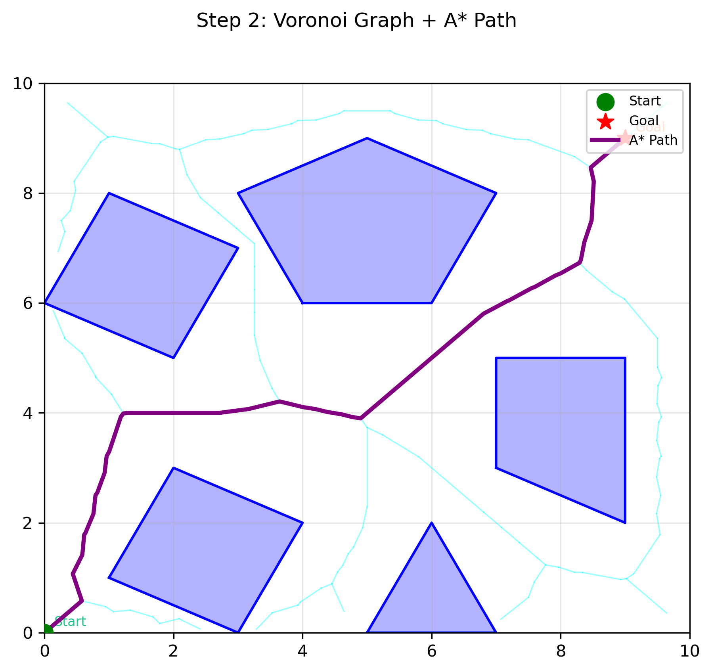

# Voronoi-Based Path Planning

A Python implementation of a 2D path-planning algorithm that uses a **Voronoi-based roadmap** and **A\* search** to find collision-free paths through environments containing polygonal obstacles.

The project constructs a graph from Voronoi edges in free space, connects the start and goal positions to the roadmap, and uses A* to search for a valid path.



## How It Works

The path-planning process consists of several stages:

1. **Environment representation** — The environment is defined using polygonal obstacles together with start and goal positions.
2. **Voronoi roadmap construction** — Voronoi edges are generated from sampled obstacle boundaries to create paths that tend to maintain distance from nearby obstacles.
3. **Collision checking** — Invalid graph edges that intersect obstacles are removed.
4. **Start and goal connection** — The start and goal positions are connected to suitable nodes in the roadmap.
5. **A\* search** — A* searches the resulting graph for a collision-free route from the start to the goal.
6. **Visualization** — The environment, Voronoi roadmap, and resulting path are visualized using Matplotlib.

## Technologies

- Python
- NumPy
- SciPy
- Shapely
- Matplotlib

## Testing

The implementation is evaluated across seven scenarios designed to test different path-planning conditions:

- Basic obstacle environment
- Narrow passage
- Mixed obstacle shapes
- Vertical barriers
- Diagonal path planning
- Environment with no valid path
- Dense obstacle environment

These scenarios test both successful path generation and the algorithm's ability to recognize when no collision-free path exists.

## Running the Project

Clone the repository:

```bash
git clone <repository-url>
cd voronoi-path-planning
```

Install the required dependencies:

```bash
pip install -r requirements.txt
```

Then open:

```text
voronoi_path_planning.ipynb
```

in Jupyter Notebook, JupyterLab, VS Code, or another environment that supports Jupyter notebooks and run the cells in order.

## Project Structure

```text
voronoi-path-planning/
├── images/
│   └── example_path.png
├── README.md
├── requirements.txt
└── voronoi_path_planning.ipynb
```

## Further Details

The notebook contains additional discussion of the algorithm's theoretical motivation, correctness, complexity, implementation, and evaluation across the test scenarios.